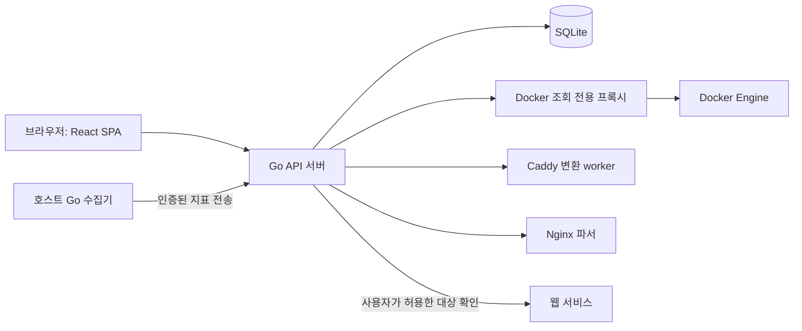

# 기술 설계

## 1. 기술 선택

| 부분 | 선택 | 이유 |
| --- | --- | --- |
| 프론트엔드 | React + TypeScript + Vite | 편집·가져오기 화면을 컴포넌트로 구성하고 정적 파일로 배포 |
| 화면 이동 | React Router | 대시보드, 가져오기, 연결 설정 화면의 URL 유지 |
| 서버 데이터 | TanStack Query | 조회 결과 캐시, 로딩·실패 상태, 변경 후 재조회 관리 |
| 스타일 | CSS Modules + CSS 변수 | 작은 앱에서 스타일 범위와 테마를 쉽게 관리 |
| 정렬 | dnd kit | 그룹과 카드 정렬에 사용, 설치 시 현행 React API 확인 |
| 백엔드 | Go + Gin | 라우팅·JSON binding·검증·middleware 작성 부담을 줄임 |
| 데이터베이스 | SQLite + GORM + `ncruces/go-sqlite3/gormlite` | struct 기반 CRUD, 별도 DB 서버와 C 컴파일러 없이 개발 |
| DB 변경 | gormigrate | 변경 이력과 순서를 관리하며 GORM으로 migration 작성 |
| 로그인 세션 | SCS + gormstore | 서버 세션 저장·만료·로그아웃 처리 재사용 |
| 설정 | envconfig | 환경변수를 설정 struct로 읽고 기본값·필수값 처리 |
| Nginx 분석 | nginx-go-crossplane | 설정 문법·블록·파일 참조 처리를 재사용 |
| Docker | 공식 Go SDK를 조회 전용 어댑터로 감싸기 | API 버전과 응답 차이를 모듈 내부에서 처리 |
| Caddy 변환 | 별도 제한된 worker의 `caddy adapt` | 공식 변환 결과를 사용하고 파서 실행 환경을 격리 |
| 호스트 지표 | Go 수집기 + gopsutil | CPU·RAM·디스크 수집 기능을 재사용하고 출처를 구분 |

React 문서에는 Vite, React Router, TanStack Query를 이용한 SPA 구성 방법이 안내되어 있다. 이 프로젝트의 제안은 Go가 API와 빌드된 SPA를 제공하는 구조다. [React 문서](https://react.dev/learn/build-a-react-app-from-scratch)

조회 데이터의 캐시와 동기화에는 TanStack Query를 사용한다. [공식 문서](https://tanstack.com/query/latest/docs/framework/react/overview)

Go Docker SDK는 현재 공식 문서의 `github.com/moby/moby/client`를 기준으로 한다. 구현할 때 선택한 SDK 버전의 API를 확인하고 버전 협상을 사용한다. [Docker SDK 문서](https://docs.docker.com/reference/api/engine/sdk/)

패키지를 이용하는 구체적인 방식과 코드 예시는 [07_BACKEND_PACKAGES.md](07_BACKEND_PACKAGES.md)에 정리했다. 선택한 드라이버 조합에서 migration·트랜잭션·세션 저장을 초기에 확인하고 버전을 고정한다.

## 2. 시스템 구성

Go 서버는 HTTP handler, 기능별 service, 저장소, 외부 연동 adapter로 구성한다. 첫 버전에서 API 서버를 여러 서비스로 분리하지 않는다. Caddy worker는 파일 시스템과 실행 환경을 제한해야 하므로 별도 프로세스 또는 컨테이너로 둔다.

호스트 수집기는 호스트에서 지표를 읽어 Go 서버에 보낸다. 이 전송은 대시보드의 지표 저장 API이며 Docker 데몬을 변경하지 않는다. 서버가 수집기에 명령을 보내는 기능은 없다.

## 3. 배포 구조

개발에서는 Vite 서버와 Go 서버를 따로 실행한다. `/api` 요청은 Vite 개발 프록시로 Go에 전달해 브라우저의 origin을 하나로 유지한다. 배포에서는 Vite 빌드 결과를 Go 정적 파일 handler로 제공한다. 운영 환경에 Node.js 서버는 필요 없다.

Compose에는 다음 요소를 둔다.

- `dashboard`: Go API + 프론트 빌드 파일, 영속 `/data` 볼륨, 사용자 접근 포트 하나.
- `dockerproxy`: Docker socket을 연결한 조회 전용 프록시. 포트를 호스트에 공개하지 않고 Go 서버와만 내부 네트워크를 공유한다.
- `caddy-adapter`: 변환 worker. Docker socket·DB·서버 비밀정보에 접근하지 않는다. 요청별 제한된 파일 묶음만 받는다.

Docker proxy는 필요한 조회 항목만 허용하고 변경 메서드를 차단한다. Go Docker transport에도 GET 경로 허용 목록을 적용한다. `docker.sock:ro` 마운트만으로 Docker API의 변경 요청이 차단되는 것은 아니므로 API 권한 제한을 함께 적용한다. [Homepage의 socket proxy 연결 예제](https://gethomepage.dev/configs/docker/)

원격 Docker는 구현 2차 단계로 둔다. 지원 시 TLS 인증 또는 SSH 보호를 사용하고 연결 비밀정보를 브라우저에 반환하지 않는다. [Docker 접근 보호 문서](https://docs.docker.com/engine/security/protect-access/)

## 4. 저장할 데이터

| 테이블 | 주요 필드 | 역할 |
| --- | --- | --- |
| `users` | id, username, password_hash | 관리자 계정 |
| `sessions` | SCS/gormstore의 token, data, expiry | 패키지의 세션 저장 형식 사용, 사용자 ID는 세션 data에 저장 |
| `dashboards` | id, name, revision | 대시보드와 배치 버전 |
| `groups` | id, dashboard_id, name, position | 그룹과 그룹 순서 |
| `services` | id, group_id, name, url, icon_key, description, hidden, position, revision | 사용자가 편집하는 카드 |
| `sources` | id, kind, name, content_hash, imported_at | Nginx·Caddy 가져오기 출처 |
| `source_bindings` | source_id, source_key, service_id, snapshot_json | 원본 후보와 카드의 관계 |
| `import_sessions` | id, user_id, source_id, candidates_json, expires_at, committed_at | 미리보기와 적용 상태 |
| `docker_connections` | id, name, endpoint, enabled | Docker 연결 정보 |
| `docker_bindings` | service_id, connection_id, selector_json | 카드와 컨테이너의 논리적 연결 |
| `host_collectors` | id, name, token_hash, last_seen_at | 호스트 수집기 인증 |
| `metric_samples` | host_id, captured_at, cpu_percent, memory_json, disks_json | 짧은 기간의 호스트 추세 |
| `settings` | key, value_json | 테마·표시 설정과 백업 형식 버전 |

SQLite는 gormigrate의 버전별 migration으로 관리하고 외래키를 활성화한다. WAL과 busy timeout을 적용하고 쓰기 트랜잭션은 짧게 유지한다. 초기에는 connection pool을 작게 유지해 driver 메모리와 쓰기 경쟁을 줄인다. 설정과 관계 데이터는 DB에 저장하고 수집 상태는 메모리 캐시에 둔다. 호스트 기록은 처음에는 30초 간격·24시간 보관으로 제한한다. 컨테이너 기록은 첫 버전에서 메모리의 최근 구간만 사용한다.

모든 날짜는 UTC로 저장하며 API에서는 RFC 3339 문자열을 사용한다. 화면은 사용자의 시간대로 표시한다. 문서의 일정 날짜는 한국 시간 기준이다.

## 5. 가져오기와 사용자 편집의 관계

카드 값과 원본 스냅샷을 별도로 보관한다. 재가져오기는 원본 스냅샷끼리 비교해 변경 제안을 만들고, 카드 수정은 사용자 확인 후 적용한다.

후보에는 `sourceKey`, URL, 원본 파일·줄 번호, 프록시 대상, 경고를 기록한다. `sourceKey`는 정규화한 사이트 주소·명시적 경로 등으로 만들며 줄 번호와 컨테이너 ID를 사용하지 않는다. 사이트 주소 변경이나 여러 경로의 통합은 자동으로 동일 항목임을 확정할 수 없으므로 수동 연결을 제공한다.

URL 정규화는 호스트 소문자화, 기본 포트 정리 등으로 제한한다. 경로의 대소문자·query·의미 있는 마지막 `/`를 임의로 바꾸지 않는다. HTTP redirect 전용 항목과 HTTPS 항목을 합칠 때는 명시적인 대상 일치를 확인한다.

## 6. 수집과 오류 처리

Docker 목록은 기본 10초, 선택된 컨테이너 사용량은 5초, 웹 상태는 30초 간격으로 수집한다. 수치는 초기 기본값이며 실제 부하를 확인하고 조정한다. 브라우저마다 Docker 요청을 보내지 않고 서버의 동일 캐시를 공유한다.

백그라운드 수집은 최대 동시 요청 수, 요청 timeout, 연결별 재시도 backoff를 둔다. 수집 실패 시 기존 값을 남기고 `observedAt`, `stale`, `errorCode`를 반환한다. 수집 장애가 카드 CRUD를 막지 않도록 기능별 실패를 분리한다.

CPU 첫 샘플 또는 유효하지 않은 분모는 `null`로 표시한다. CPU 표시 기준은 호스트 전체 0~100%와 컨테이너의 코어 기준을 구분한다. 컨테이너 CPU는 100%를 넘을 수 있으므로 임의로 잘라내지 않는다. RAM은 cache 처리 기준과 limit 유무를 구분한다. [Docker 컨테이너 지표 문서](https://docs.docker.com/engine/containers/runmetrics/)

## 7. 실제 권한 경계

관리자 로그인은 HttpOnly 세션 쿠키로 처리하고 변경 요청에는 CSRF 검사를 적용한다. 운영 HTTPS에서는 Secure 쿠키를 사용한다. 초기 계정 생성은 한 번만 가능한 토큰과 DB 트랜잭션으로 보호한다.

Docker adapter가 외부에 제공하는 인터페이스는 List, Inspect, Stats뿐이다. inspect에서 환경변수·mount 경로 등 불필요한 필드는 UI 응답에 넣지 않는다. 일반 HTTP 프록시 API를 만들지 않는다.

웹 상태 확인은 사용자가 활성화한 대상만 요청한다. 홈서버용 사설 주소는 명시적으로 허용하되 link-local metadata 주소는 차단한다. DNS 해석 결과와 redirect 대상을 검사하고 제한한 IP로 연결해 우회 요청을 막는다. 본문 다운로드량과 응답 시간을 제한하고 원본 서비스 쿠키·사용자 세션을 전송하지 않는다.

업로드는 파일 수·개별 크기·총량·분석 시간을 제한한다. 업로드 경로는 가상 파일 묶음 안에서만 해석한다. `..`, 절대 경로, symlink, import 순환과 과도한 중첩을 제한한다. 변환 worker는 네트워크와 호스트 파일 접근이 제한된 실행 환경을 사용한다. Caddy가 import를 처리하는 방식은 공식 문서에서 확인한다. [Caddy import 문서](https://caddyserver.com/docs/caddyfile/directives/import)
